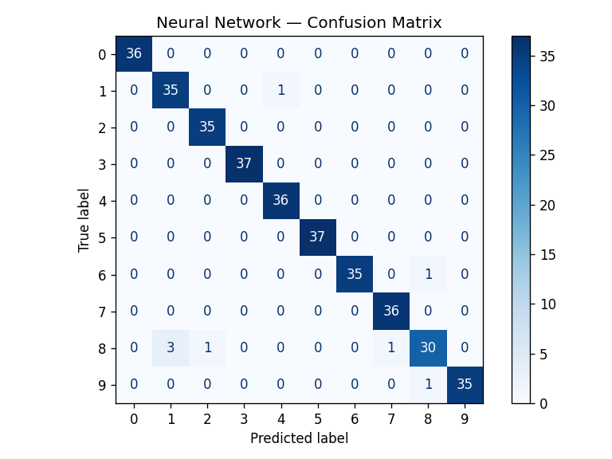

# Handwritten Digit Classification — Neural Network (MLP)

A multi-class image classification project that recognizes handwritten digits (0–9)
using a **Multi-Layer Perceptron (feedforward neural network)** trained with
backpropagation — the foundational deep learning architecture.

## Dataset
`digits` dataset (scikit-learn) — 1,797 samples of 8×8 grayscale handwritten digit
images (64 pixel features), 10 classes. Same family of problem as the classic MNIST
digit recognition task, at a smaller scale.

## Approach
- Loaded and visualized the digit images
- Split data into train/test sets (80/20, stratified)
- Scaled pixel features with `StandardScaler`
- Trained a baseline **Logistic Regression** model for comparison
- Built and trained a **Neural Network (MLP)**: 64 → 100 → 50 → 10 architecture,
  ReLU activation, Adam optimizer, trained via backpropagation over 92 epochs

## Results

| Model                        | Test Accuracy |
|-------------------------------|:-------------:|
| Logistic Regression (baseline)| 97.22%        |
| **Neural Network (MLP)**      | **97.78%**    |

The neural network outperforms the linear baseline, correctly classifying 352/360
held-out test images across all 10 digit classes.



## Tech Stack
Python, NumPy, Scikit-learn, Matplotlib

## How to Run
```bash
pip install numpy scikit-learn matplotlib
python digit_classifier_nn.py
```

## Key Concepts Demonstrated
Neural network architecture design (hidden layers, activation functions),
backpropagation training, train/test evaluation, baseline comparison, and
confusion-matrix-based error analysis.
